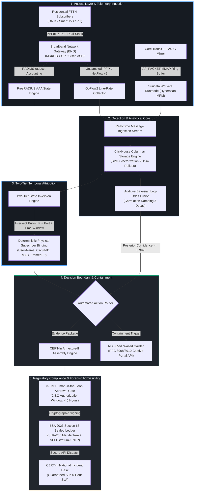

  <picture>
    <source media="(prefers-color-scheme: dark)" srcset="assets/logo.png">
    
  </picture>

<h1 align="center">A R C U S</h1>

  <strong>Autonomous Subscriber Compromise Detection, CGNAT Attribution & Regulatory Compliance Architecture</strong>

  <em>Line-rate intelligence and sovereign audit defensibility for regional Tier-2 and Tier-3 FTTH broadband access networks.</em>

  
  
  
  
  

  <a href="#-core-problem-space">Problem Space</a> •
  <a href="#-architectural-data-flow">Data Flow Architecture</a> •
  <a href="#-the-25-chapter-research-corpus">Research Dossier</a> •
  <a href="#-technical-pillars--breakthroughs">Technical Pillars</a> •
  <a href="#-hardware-capacity-matrices">Hardware Sizing</a> •
  <a href="#-governance--ip">Governance</a>

---

> [!IMPORTANT]
> **Pre-Project Engineering Baseline:** This repository contains the peer-reviewable theoretical, mathematical, empirical, and statutory research foundation for the **ARCUS** system. It documents line-rate packet acquisition physics, Carrier-Grade NAT translation formulas, disassembled malware telemetry, and Indian statutory compliance directives prior to production codebase execution.

---

## 🎯 Core Problem Space

Regional broadband operators across Indian telecom circles operate under severe economic and legal pressures:

| Structural Challenge | Operational Reality | Carrier Impact without ARCUS |
| :--- | :--- | :--- |
| **CGNAT Attribution Blindness** | Millions of sessions multiplexed across shared public IPv4 pools (RFC 6888 / RFC 6598). | Inability to resolve an abuse tuple $\langle IP_{\text{pub}}, Port_{\text{pub}}, t_{\text{incident}} \rangle$ to a physical customer line. |
| **Dynamic NAT Log Explosion** | Per-session logging for 10,000 subscribers generates **2.16 billion records/day** ($172.8\text{ GB/day}$). | Router CPU crashes, dropped NetFlow packets, and unsustainable multi-terabyte database costs. |
| **The Base Rate Fallacy** | Low subscriber infection base rate ($P(C) \approx 0.005$) across residential lines. | Single-rule IDS alerts produce a **66.8% False Discovery Rate**, causing mass wrongful quarantines and customer churn. |
| **Mandatory 6-Hour SLA Clock** | CERT-In Directions 2022 enforce a strict **6-hour reporting window** from incident notice. | Manual triage breaches SLA, exposing executives to **₹1 Crore fines** (Jan Vishwas Act 2023) and Section 85 liability. |
| **Digital Evidence Overhaul** | BSA 2023 Section 63 replaces Indian Evidence Act 65B (effective July 2024). | Unverified raw logs are legally inadmissible without SHA-256 Merkle chains and NPLI Stratum-1 time sync. |

---

## ⚡ Architectural Data Flow

---

## 📚 The 25-Chapter Research Corpus

The full pre-project findings are modularized inside the [`research/`](research/) directory. You can also browse them locally through the interactive reader at [`research/index.html`](research/index.html).

<b>📖 Research Domain Directory Map</b>

 

| Domain | Focus & Critical Findings | Dossier Links |
| :--- | :--- | :--- |
| **00. Meta & Methodology** | Verification boundaries, primary standards (RFC, Gazette, Acts), source tiers. | [`methodology.md`](research/docs/methodology.md) • [`README.md`](research/docs/README.md) |
| **01. Access Foundations** | BNG/BRAS architectures, PPPoE cryptographic session binding vs. IPoE DAI/IPSG; flow sampling degradation math (1:1000 sampling drops 23.7% of C2 beacons). | [`broadband-access-topologies.md`](research/docs/foundations/broadband-access-topologies.md) • [`telemetry-mechanisms.md`](research/docs/foundations/telemetry-mechanisms.md) |
| **02. CGNAT & Attribution** | RFC 6888/6598 standards; mathematical proof of **99.997% log reduction** via Port Block Allocation (PBA); FreeRADIUS two-tier temporal state intersection and orphaned session recovery. | [`cgnat-architecture-and-standards.md`](research/docs/cgnat-attribution/cgnat-architecture-and-standards.md) • [`log-volume-mathematics.md`](research/docs/cgnat-attribution/log-volume-mathematics.md) • [`radius-accounting-and-attribution.md`](research/docs/cgnat-attribution/radius-accounting-and-attribution.md) |
| **03. Threat Intelligence** | Source disassembly of Mirai `scanner.c` (LCG RNG, 68 credentials, DoD exclusion list); Mozi BitTorrent DHT + ECDSA384 authentication; BadBox AOSP rootkits & upload/download ratio inversion ($\ge 1.0$ vs. normal $1:10$); Syrotech/Netlink ONT exploits; UDP amplification matrices. | [`mirai-botnet-family.md`](research/docs/threat-intel/mirai-botnet-family.md) • [`mozi-p2p-botnet.md`](research/docs/threat-intel/mozi-p2p-botnet.md) • [`residential-proxies-and-abuse.md`](research/docs/threat-intel/residential-proxies-and-abuse.md) • [`target-cpe-vulnerabilities.md`](research/docs/threat-intel/target-cpe-vulnerabilities.md) • [`outbound-abuse-profiles.md`](research/docs/threat-intel/outbound-abuse-profiles.md) |
| **04. Detection Analytics** | Suricata `workers` zero-lock runmode; AF_PACKET MMAP ring buffer vs. DPDK; Intel Hyperscan SIMD acceleration; mathematical proof of Base Rate Fallacy; additive log-odds fusion ($\ln \text{Odds} = \ln \text{Prior} + \sum \alpha_i \ln LR_i$); ClickHouse columnar SIMD engine with 2-year retention TTLs. | [`suricata-line-rate-engine.md`](research/docs/detection-analytics/suricata-line-rate-engine.md) • [`bayesian-log-odds-fusion.md`](research/docs/detection-analytics/bayesian-log-odds-fusion.md) • [`clickhouse-columnar-storage.md`](research/docs/detection-analytics/clickhouse-columnar-storage.md) |
| **05. Containment & Remediation** | RFC 6561 Walled Garden lifecycle; RFC 8908 & RFC 8910 Captive Portal API solving browser HSTS/TLS certificate warning lockouts; Essential OS/AV update Safe Harbor whitelists; Active synthetic scanning & 30-minute tiered probation ladder. | [`rfc6561-walled-garden-framework.md`](research/docs/containment-remediation/rfc6561-walled-garden-framework.md) • [`captive-portal-api-standards.md`](research/docs/containment-remediation/captive-portal-api-standards.md) • [`safe-harbor-remediation-whitelist.md`](research/docs/containment-remediation/safe-harbor-remediation-whitelist.md) • [`verification-and-probation-ladder.md`](research/docs/containment-remediation/verification-and-probation-ladder.md) |
| **06. Regulatory Compliance** | Section 70B IT Act 2000; CERT-In 4-phase countdown state machine; Jan Vishwas Act 2023 ₹1 Crore penalties; Complete mapping of 20 Annexure-I incident categories to telemetry; Human-in-the-loop legal gate; BSA 2023 Section 63 Schedule Part A/B electronic evidence certificates with SHA-256 Merkle trees & NPLI Stratum-1 time sync. | [`cert-in-directions-and-sla.md`](research/docs/regulatory-compliance/cert-in-directions-and-sla.md) • [`annexure-mapping-and-reporting.md`](research/docs/regulatory-compliance/annexure-mapping-and-reporting.md) • [`human-approval-gate-rationale.md`](research/docs/regulatory-compliance/human-approval-gate-rationale.md) • [`bsa-2023-section-63-evidence.md`](research/docs/regulatory-compliance/bsa-2023-section-63-evidence.md) |
| **07. Evidence & Sizing** | Comprehensive primary standards ledger (RFCs, Gazette orders, Acts, CVEs); Commodity 1U/2U server capacity sizing matrices for 5,000, 15,000, and 30,000 subscriber tiers. | [`standards-and-rfc-ledger.md`](research/docs/evidence/standards-and-rfc-ledger.md) • [`hardware-capacity-specifications.md`](research/docs/evidence/hardware-capacity-specifications.md) |

---

## 🔬 Technical Pillars & Breakthroughs

### 1. The PBA Log Volume Reduction (99.997%)
Under standard per-session NAT, every single TCP/UDP connection emits a session create and session delete log. For a 10,000-subscriber FTTH network, this creates **50,000 log events/sec** ($172.8\text{ GB/day}$).

ARCUS adopts **Port Block Allocation (PBA)** (RFC 6888 / RFC 7422):
$$\text{Reduction Factor} = \frac{2,160,000,000 \text{ rows/day}}{60,000 \text{ rows/day}} = 36,000\times \quad (\mathbf{99.9972\% \text{ reduction}})$$

Router CPU stays below 5%, and 2 years of complete NAT translation logs consume only **3.5 GB of storage**, fully adhering to domestic retention laws without enterprise storage costs.

### 2. Defeating the Base Rate Fallacy
In an ISP with $0.5\%$ infection prevalence ($P(C) = 0.005$), a signature with $99\%$ sensitivity and $1\%$ false positives yields:
$$P(C \mid T^+) = \frac{0.99 \times 0.005}{(0.99 \times 0.005) + (0.01 \times 0.995)} \approx 33.22\% \implies \mathbf{66.78\% \text{ False Discovery Rate}}$$

ARCUS fuses multiple orthogonal telemetry signals using **Additive Bayesian Log-Odds**:
$$\ln \text{Odds}_{\text{posterior}} = \ln \text{Odds}_{\text{prior}} + \sum_{i=1}^{k} \alpha_i \ln LR_i$$

Only when posterior confidence surpasses **99.9%** ($P(C \mid E) \ge 0.999$) is automated quarantine engaged.

### 3. Captive Portal Modernization (RFC 8908 & RFC 8910)
Legacy captive portals intercept HTTPS with DNAT, triggering browser HSTS and SSL warnings that break connectivity and blind the customer. ARCUS broadcasts **DHCP Option 114** (`https://portal.isp.net/api/captive-portal`), allowing modern operating systems (Windows, iOS, Android, macOS) to invoke their native **Captive Network Assistant (CNA)** seamlessly.

### 4. BSA 2023 Section 63 Forensic Admissibility
To satisfy Section 63 of the Bharatiya Sakshya Adhiniyam, 2023:
* Flow and NAT batches are hashed using **SHA-256** every 15 minutes.
* Batch hashes are sealed in an immutable **Merkle tree**.
* System time is certified against **National Physical Laboratory of India (NPLI) Stratum-1 NTP**.
* Generates statutory **Schedule Part A and Part B** electronic certificates with zero manual paperwork.

---

## 🖥️ Hardware Capacity Matrices

ARCUS is engineered to operate on commodity off-the-shelf x86-64 rackmount appliances without specialized ASIC proprietary appliances:

| Metric / Component | Tier-A (5,000 Subscribers) | Tier-B (15,000 Subscribers) | Tier-C (30,000 Subscribers) |
| :--- | :--- | :--- | :--- |
| **Peak Transit Throughput** | 2.5 Gbps to 5.0 Gbps | 8.0 Gbps to 15.0 Gbps | 18.0 Gbps to 30.0 Gbps |
| **Unsampled Flow Export** | 6,250 flows/sec | 18,750 flows/sec | 37,500 flows/sec |
| **Server Form Factor** | 1U Rackmount | 1U/2U Rackmount | 2U Rackmount |
| **Processor (CPU)** | 1x AMD EPYC 4344P (8c/16t, 3.8 GHz) | 1x AMD EPYC 8324P (32c/64t) | 2x AMD EPYC 9124 (2x 16c/64t) |
| **System Memory (RAM)** | 32 GB DDR5 ECC | 64 GB DDR5 ECC | 128 GB DDR5 ECC (8-channel) |
| **Network Interfaces** | Dual-Port 10G SFP+ (Intel X520 / X710) | Quad-Port 10G/25G (Intel E810 / CX-5) | Dual-Port 40G/100G (Mellanox CX-6) |
| **Hot Storage (NVMe SSD)** | 2x 960 GB NVMe (RAID 1) | 2x 1.92 TB NVMe (RAID 1, 3 DWPD) | 4x 1.92 TB NVMe (RAID 10, 3 DWPD) |
| **Cold Storage (Archive)** | 2x 4 TB Enterprise SATA (ZFS mirror) | 4x 8 TB Enterprise SATA (ZFS RAID10) | 4x 16 TB Enterprise SATA (ZFS pool) |

---

## 🛡️ Governance & IP

* **Organization:** Developed under the **[ToxArch](https://github.com/ToxArch)** cybersecurity defense organization.
* **Licensing:** Strategic licensing model is under active legal evaluation. **All rights reserved by ToxArch.**
* **Security & Responsible Disclosure:** To report a potential vulnerability in the research or architecture, please contact the security desk via official ToxArch channels.
