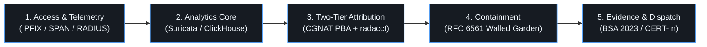
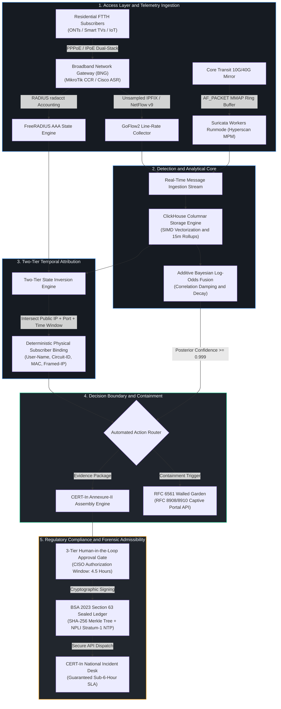

<h1 align="center">A R C U S</h1>

  <strong>Autonomous Subscriber Compromise Detection, CGNAT Attribution and Regulatory Compliance Architecture</strong>

  <em>Pre-project research dossier, architectural foundations, and standards synthesis for regional Tier-2 and Tier-3 FTTH broadband access networks.</em>

  
  
  

  <a href="#core-problem-space">Problem Space</a> |
  <a href="#conceptual-architecture">Conceptual Architecture</a> |
  <a href="#the-25-chapter-research-corpus">Research Corpus</a> |
  <a href="#hardware-sizing-reference">Hardware Sizing</a> |
  <a href="#governance-and-ip">Governance</a>

---

> [!NOTE]
> **Pre-Project Engineering Baseline:** This repository contains the peer-reviewable theoretical, mathematical, empirical, and statutory research foundation for the ARCUS architecture. It compiles line-rate packet acquisition principles, Carrier-Grade NAT translation standards, disassembled malware telemetry profiles, and Indian statutory compliance directives. It does not contain untested implementation code or post-project evaluation claims.

---

## Core Problem Space

Regional broadband operators across Indian telecom circles operate under unique structural, economic, and regulatory conditions:

| Domain | Structural Condition | Technical and Regulatory Impact |
| :--- | :--- | :--- |
| **CGNAT Attribution** | Subscribers share common public IPv4 address pools under Carrier-Grade NAT (RFC 6888 / RFC 6598). | Resolving an abuse report tuple (IP, port, timestamp) requires temporal state correlation across NAT and AAA sessions. |
| **Translation Log Volume** | Per-session dynamic NAT generates thousands of connection records per active subscriber daily. | Creates high I/O write volume on routers, requiring port block allocation (RFC 7422) architectures to remain viable. |
| **Classification Accuracy** | Low baseline subscriber infection prevalence in residential pools (approx. 0.5%). | Unfused detection signatures face base-rate fallout, necessitating multi-signal fusion to control false quarantines. |
| **Reporting Timelines** | CERT-In Directions 2022 mandate incident reporting within a 6-hour window from notice. | Requires automated incident assembly, structured Annexure schemas, and defined human verification workflows. |
| **Evidence Admissibility** | BSA 2023 Section 63 governs electronic records admissibility (replacing Indian Evidence Act Section 65B). | Electronic records require verifiable hash integrity, structured certification, and synchronized time references. |

---

## Conceptual Architecture

<b>Detailed Subsystem Data Flow (click to expand)</b>

 

---

## The 25-Chapter Research Corpus

The full pre-project findings are modularized inside the [`research/`](research/) directory. You can also browse them locally through the interactive reader at [`research/index.html`](research/index.html).

<b>Research Domain Directory Map</b>

 

| Domain | Focus and Research Scope | Dossier Links |
| :--- | :--- | :--- |
| **00. Meta and Methodology** | Verification boundaries, primary standards (RFC, Gazette, Acts), source tiers. | [`methodology.md`](research/docs/methodology.md) | [`README.md`](research/docs/README.md) |
| **01. Access Foundations** | BNG/BRAS architectures, PPPoE cryptographic session binding vs. IPoE DAI/IPSG; flow sampling degradation math (1:1000 sampling drops 23.7% of C2 beacons). | [`broadband-access-topologies.md`](research/docs/foundations/broadband-access-topologies.md) | [`telemetry-mechanisms.md`](research/docs/foundations/telemetry-mechanisms.md) |
| **02. CGNAT and Attribution** | RFC 6888/6598 standards; mathematical models of Port Block Allocation (PBA); FreeRADIUS two-tier temporal state intersection and orphaned session recovery. | [`cgnat-architecture-and-standards.md`](research/docs/cgnat-attribution/cgnat-architecture-and-standards.md) | [`log-volume-mathematics.md`](research/docs/cgnat-attribution/log-volume-mathematics.md) | [`radius-accounting-and-attribution.md`](research/docs/cgnat-attribution/radius-accounting-and-attribution.md) |
| **03. Threat Intelligence** | Source disassembly of Mirai `scanner.c` (LCG RNG, 68 credentials, DoD exclusion list); Mozi BitTorrent DHT and ECDSA384 authentication; BadBox AOSP rootkits and upload/download ratio inversion; Syrotech/Netlink ONT exploits; UDP amplification matrices. | [`mirai-botnet-family.md`](research/docs/threat-intel/mirai-botnet-family.md) | [`mozi-p2p-botnet.md`](research/docs/threat-intel/mozi-p2p-botnet.md) | [`residential-proxies-and-abuse.md`](research/docs/threat-intel/residential-proxies-and-abuse.md) | [`target-cpe-vulnerabilities.md`](research/docs/threat-intel/target-cpe-vulnerabilities.md) | [`outbound-abuse-profiles.md`](research/docs/threat-intel/outbound-abuse-profiles.md) |
| **04. Detection Analytics** | Suricata `workers` zero-lock runmode; AF_PACKET MMAP ring buffer vs. DPDK; Intel Hyperscan SIMD acceleration; mathematical proof of Base Rate Fallacy; additive log-odds fusion; ClickHouse columnar storage engine with retention TTLs. | [`suricata-line-rate-engine.md`](research/docs/detection-analytics/suricata-line-rate-engine.md) | [`bayesian-log-odds-fusion.md`](research/docs/detection-analytics/bayesian-log-odds-fusion.md) | [`clickhouse-columnar-storage.md`](research/docs/detection-analytics/clickhouse-columnar-storage.md) |
| **05. Containment and Remediation** | RFC 6561 Walled Garden lifecycle; RFC 8908 and RFC 8910 Captive Portal API solving browser HSTS/TLS certificate warning lockouts; Essential OS/AV update Safe Harbor whitelists; Active synthetic scanning and 30-minute tiered probation ladder. | [`rfc6561-walled-garden-framework.md`](research/docs/containment-remediation/rfc6561-walled-garden-framework.md) | [`captive-portal-api-standards.md`](research/docs/containment-remediation/captive-portal-api-standards.md) | [`safe-harbor-remediation-whitelist.md`](research/docs/containment-remediation/safe-harbor-remediation-whitelist.md) | [`verification-and-probation-ladder.md`](research/docs/containment-remediation/verification-and-probation-ladder.md) |
| **06. Regulatory Compliance** | Section 70B IT Act 2000; CERT-In 4-phase countdown state machine; Jan Vishwas Act 2023 penalty structure; Complete mapping of 20 Annexure-I incident categories to telemetry; Human-in-the-loop legal gate; BSA 2023 Section 63 Schedule Part A/B electronic evidence certificates with SHA-256 Merkle trees and NPLI Stratum-1 time sync. | [`cert-in-directions-and-sla.md`](research/docs/regulatory-compliance/cert-in-directions-and-sla.md) | [`annexure-mapping-and-reporting.md`](research/docs/regulatory-compliance/annexure-mapping-and-reporting.md) | [`human-approval-gate-rationale.md`](research/docs/regulatory-compliance/human-approval-gate-rationale.md) | [`bsa-2023-section-63-evidence.md`](research/docs/regulatory-compliance/bsa-2023-section-63-evidence.md) |
| **07. Evidence and Sizing** | Comprehensive primary standards ledger (RFCs, Gazette orders, Acts, CVEs); Commodity 1U/2U server capacity sizing matrices for 5,000, 15,000, and 30,000 subscriber tiers. | [`standards-and-rfc-ledger.md`](research/docs/evidence/standards-and-rfc-ledger.md) | [`hardware-capacity-specifications.md`](research/docs/evidence/hardware-capacity-specifications.md) |

---

## Hardware Sizing Reference

Reference hardware capacity specifications derived for x86-64 server architectures across standard subscriber tiers:

| Component / Metric | Tier-A (5,000 Subscribers) | Tier-B (15,000 Subscribers) | Tier-C (30,000 Subscribers) |
| :--- | :--- | :--- | :--- |
| **Estimated Peak Throughput** | 2.5 Gbps to 5.0 Gbps | 8.0 Gbps to 15.0 Gbps | 18.0 Gbps to 30.0 Gbps |
| **Unsampled Flow Export** | 6,250 flows/sec | 18,750 flows/sec | 37,500 flows/sec |
| **Chassis Form Factor** | 1U Rackmount | 1U/2U Rackmount | 2U Rackmount |
| **Processor Sizing** | 8 cores / 16 threads | 32 cores / 64 threads | 32 to 64 cores |
| **System Memory (ECC)** | 32 GB DDR5 | 64 GB DDR5 | 128 GB DDR5 |
| **Network Interfaces** | Dual-Port 10G SFP+ | Quad-Port 10G/25G | Dual-Port 40G/100G |
| **Primary Storage (NVMe)** | 2x 960 GB (RAID 1) | 2x 1.92 TB (RAID 1) | 4x 1.92 TB (RAID 10) |
| **Secondary Storage (Archive)** | 2x 4 TB Enterprise SATA | 4x 8 TB Enterprise SATA | 4x 16 TB Enterprise SATA |

---

## Governance and IP

* **Organization:** Maintained under the **[ToxArch](https://github.com/ToxArch)** cybersecurity defense organization.
* **Licensing:** Strategic licensing model is under evaluation. **All rights reserved by ToxArch.**
* **Scope Notice:** This repository is strictly restricted to pre-project technical research, mathematical derivations, and architecture specifications.
